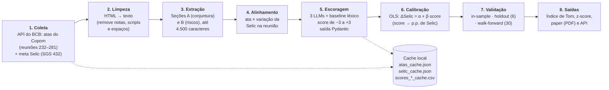
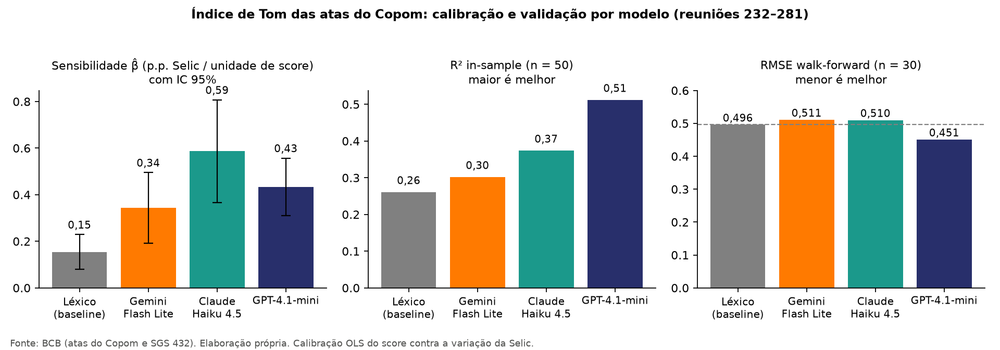
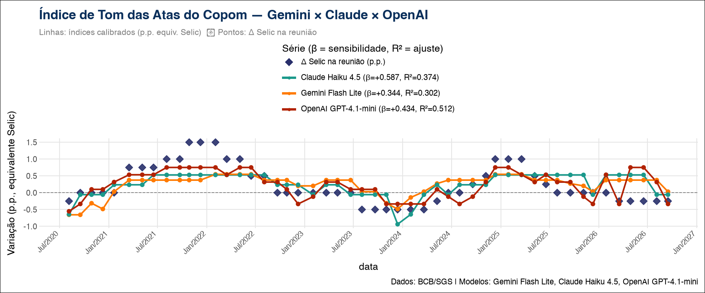

# Mesmo Sinal, Calibrações Diferentes: Um Índice de Tom das Atas do Copom com Múltiplos LLMs

### Comparação entre Gemini Flash Lite, Claude Haiku 4.5 e GPT-4.1-mini

#### Aluno: [Vítor Wilher Rodrigues de Lima](https://github.com/vitorwilher)
#### Orientadora: Evelyn Conceição Santos Batista.

---

Trabalho apresentado ao curso de Pós-Graduação em Inteligência Artificial e LLMs da PUC-Rio como pré-requisito para conclusão de curso.

- [Link para o código](sentimento_copom_IA_base.qmd).

- [Link para a monografia](sentimento_copom_IA_publico.pdf).

- Trabalhos relacionados:
    - [Can ChatGPT Decipher Fedspeak? (Hansen e Kazinnik, 2023)](https://papers.ssrn.com/sol3/papers.cfm?abstract_id=4399406).
    - [Transparency and Deliberation Within the FOMC: A Computational Linguistics Approach (Hansen, McMahon e Prat, 2018)](https://doi.org/10.1093/qje/qjx045).

---

### Resumo

A comunicação dos bancos centrais é, em si, um instrumento de política monetária, e as atas do Comitê de Política Monetária (Copom) do Banco Central do Brasil concentram, em escolhas sutis de linguagem, informação relevante sobre a direção futura da Selic. Este trabalho constrói um Índice de Tom *hawkish-dovish* das atas do Copom utilizando três modelos de linguagem de grande porte (LLMs) — Gemini Flash Lite (Google), Claude Haiku 4.5 (Anthropic) e GPT-4.1-mini (OpenAI) — em um *pipeline* reprodutível em Python, com saída estruturada via Pydantic e cache local incremental que torna a atualização contínua do índice viável a custo marginal próximo de zero.

O mesmo *prompt* é aplicado aos mesmos textos pelos três provedores, e os *scores* brutos são calibrados em pontos percentuais equivalentes da Selic via regressão linear. A robustez é testada em três camadas de validação: inferência *in-sample* (erros-padrão, *p*-valores e intervalos de confiança), *holdout* das últimas seis reuniões e validação cruzada *walk-forward* sobre toda a amostra. Para as 50 reuniões entre a 232 (agosto de 2020) e a 281 (setembro de 2026), o GPT-4.1-mini lidera tanto *in-sample* (R² ≈ 0,51) quanto na *walk-forward* (RMSE 0,451, cerca de 9% melhor que um baseline léxico), seguido do Claude Haiku 4.5 (R² ≈ 0,37) e do Gemini Flash Lite (R² ≈ 0,30).

Os três modelos concordam sobre a direção do tom (correlações de 0,67 a 0,77 entre os *scores*), mas divergem sobre a intensidade com que essa direção se traduz em variação da Selic: a sensibilidade β̂ varia de +0,34 a +0,59 p.p. por unidade de *score*. O *holdout* revela ainda um ponto cego comum aos três LLMs: no início do ciclo de cortes de 2026, a partir de uma Selic de 15%, a linguagem das atas segue restritiva e os modelos leem o nível de aperto monetário, não a direção da próxima decisão.

### Abstract

Central bank communication is, in itself, a monetary policy instrument, and the minutes of Brazil's Monetary Policy Committee (Copom) concentrate, in subtle language choices, meaningful information about the future path of the Selic rate. This work builds a hawkish-dovish Tone Index of Copom minutes using three large language models (LLMs) — Gemini Flash Lite (Google), Claude Haiku 4.5 (Anthropic), and GPT-4.1-mini (OpenAI) — within a reproducible Python pipeline featuring Pydantic-based structured output and incremental local caching, which makes continuous updating of the index viable at near-zero marginal cost.

The same prompt is applied to the same texts by all three providers, and the raw scores are calibrated in percentage-point equivalents of the Selic rate via linear regression. Robustness is tested through three validation layers: in-sample inference (standard errors, p-values, and confidence intervals), a holdout of the last six meetings, and walk-forward cross-validation over the full sample. Over the 50 meetings from 232 (August 2020) to 281 (September 2026), GPT-4.1-mini leads both in-sample (R² ≈ 0.51) and in walk-forward (RMSE 0.451, around 9% better than a lexicon baseline), followed by Claude Haiku 4.5 (R² ≈ 0.37) and Gemini Flash Lite (R² ≈ 0.30).

The three models agree on the direction of the tone (correlations of 0.67 to 0.77 among scores) but diverge on the intensity with which it translates into Selic-rate changes: the sensitivity β̂ ranges from +0.34 to +0.59 percentage points per unit of score. The holdout also reveals a blind spot shared by all three LLMs: at the start of the 2026 easing cycle, from a 15% Selic rate, the minutes' language remains restrictive and the models read the level of monetary tightening, not the direction of the next decision.

### 1. Introdução

Desde a virada da transparência nos bancos centrais, a comunicação passou a ser tratada como instrumento de política monetária em si: o que o comitê diz sobre inflação, expectativas e balanço de riscos move preços de ativos e expectativas antes mesmo da próxima decisão de juros. No Brasil, as atas do Copom são o principal veículo dessa comunicação. A literatura de análise de texto aplicada a bancos centrais evoluiu de dicionários de palavras (no espírito de Loughran e McDonald) para modelos de tópicos e, mais recentemente, para LLMs capazes de ler o tom em contexto — mas a evidência para o português e para o Copom ainda é escassa.

Este trabalho busca mensurar o tom das atas do Copom em uma escala interpretável, calibrada em pontos percentuais da Selic, e responder a uma pergunta prática para quem pretende usar esse tipo de índice em produção: a escolha do provedor de LLM importa? Para isso, três LLMs comerciais de baixo custo leem os mesmos textos com o mesmo *prompt*, e suas leituras são comparadas entre si e contra um baseline léxico.

### 2. Modelagem

O projeto segue o fluxo CRISP-DM. Os dados são coletados automaticamente das APIs públicas do Banco Central: as atas do Copom a partir da reunião 232 (agosto de 2020) e a meta Selic (série SGS 432). Cada ata passa por limpeza de HTML e extração das seções A (atualização da conjuntura) e B (cenários e balanço de riscos), que concentram o diagnóstico do comitê sem a decisão de juros já anunciada. A variável-alvo é a variação da Selic decidida na reunião correspondente.

Na etapa de modelagem, um *prompt* único pede a cada LLM um *score* de −3 (fortemente *dovish*) a +3 (fortemente *hawkish*), com âncoras descritivas para cada nível. A saída é estruturada via Pydantic e orquestrada com LangChain, com `temperature = 0` e cache incremental por provedor — só as atas novas são escoradas a cada atualização. Os *scores* de cada modelo são então calibrados por regressão OLS contra a variação da Selic, o que transforma o tom em pontos percentuais equivalentes e permite comparar sensibilidade (β̂) e ajuste (R²) entre os modelos. Um baseline léxico de termos *hawkish* e *dovish* em português serve de piso de comparação.

#### 2.1 Fluxo do *pipeline*: do site do BCB ao índice

O diagrama abaixo mostra o caminho que cada ata percorre. As setas cheias são as etapas do processamento. As setas tracejadas indicam o que fica guardado em cache, para não ser baixado nem pago de novo.



O que acontece em cada etapa, e por quê:

| Etapa | O que faz | Por que é feita assim |
|---|---|---|
| **1. Coleta** | Baixa o texto de cada ata pela API pública do BCB e a meta Selic pela série 432 do SGS. | Fontes oficiais e automatizáveis: o índice pode ser atualizado a cada reunião sem intervenção manual. |
| **2. Limpeza** | Converte o HTML em texto puro e remove notas de rodapé, *scripts* e espaços repetidos. | O LLM deve ler só o conteúdo da ata. Marcação HTML gasta *tokens* e pode confundir o modelo. |
| **3. Extração** | Isola as seções A (atualização da conjuntura) e B (cenários e balanço de riscos). | É nelas que está o diagnóstico do comitê. As seções seguintes repetem a decisão já anunciada, que o modelo não deve ver. O recorte também corta cerca de 50% dos *tokens*. |
| **4. Alinhamento** | Associa cada ata à variação da Selic decidida na mesma reunião. | Essa variação (em p.p.) é a variável-alvo contra a qual o tom é calibrado. |
| **5. Escoragem** | Envia o mesmo *prompt* aos três LLMs, que devolvem uma nota de −3 (muito *dovish*) a +3 (muito *hawkish*). Um dicionário de termos em português produz o baseline. | `temperature = 0` deixa a resposta o mais determinística possível. O Pydantic obriga o modelo a responder num formato fixo (`{"score": número}`), e isso dispensa interpretar texto livre. |
| **6. Calibração** | Estima, por OLS, ΔSelic = α + β · *score* para cada modelo. | Converte uma nota abstrata em pontos percentuais de Selic, uma unidade que o economista entende e que permite comparar os modelos entre si. |
| **7. Validação** | Mede o ajuste dentro da amostra, numa janela final reservada (*holdout*) e em previsões sucessivas (*walk-forward*). | Um bom ajuste dentro da amostra não garante capacidade de previsão. As três camadas respondem a críticas diferentes (ver seção 3). |
| **8. Saídas** | Gera o Índice de Tom, o *z-score* de surpresa de comunicação, o paper em PDF e uma API. | O índice fica disponível tanto para leitura humana (paper) quanto para outros sistemas (API). |

**O papel do cache.** Cada ata baixada e cada nota recebida são gravadas em arquivos locais. Na execução seguinte, o código consulta esses arquivos antes de chamar a internet ou um LLM, e só processa o que é novo. Na prática, com o cache completo, gerar o paper de novo não faz nenhuma chamada paga.

#### 2.2 Modelos e versões

Foram escolhidos os modelos de menor custo de cada provedor (segmento *small & cheap*), porque o objetivo é um índice que possa ser atualizado continuamente a custo próximo de zero.

| Modelo | Identificador usado no código | Versão efetiva | Parâmetros |
|---|---|---|---|
| Gemini Flash Lite (Google) | `gemini-flash-lite-latest` | *alias* "latest": em out/2026 a API o resolve para `gemini-3.5-flash-lite` | `temperature=0`, saída `json_schema` |
| Claude Haiku 4.5 (Anthropic) | `claude-haiku-4-5` | *snapshot* `claude-haiku-4-5-20251001` | `temperature=0`, `max_tokens=300` |
| GPT-4.1-mini (OpenAI) | `gpt-4.1-mini` | *snapshot* `gpt-4.1-mini-2025-04-14` | `temperature=0`, `timeout=45s` |

**Alias ou *snapshot*?** Um *snapshot* (como `claude-haiku-4-5-20251001`) é uma versão congelada: o mesmo nome sempre aponta para o mesmo modelo. Um *alias* "latest" é um apelido que o provedor move para a versão mais recente.

**Ressalva sobre o Gemini.** O código usa o *alias* `gemini-flash-lite-latest`. As atas foram escoradas em três rodadas (abr/2026, jul/2026 e out/2026), e o cache não registra a versão que respondeu a cada chamada. Por isso, não é possível garantir que as 50 atas tenham sido lidas pela mesma versão do Gemini. Fixar a versão explícita no código é um dos ajustes previstos para a v2.0.

#### 2.3 Quanto custa

Os provedores cobram por *token*, que é um pedaço de palavra (em português, cerca de 3 a 4 caracteres). A conta tem três passos:

1. **Contar os *tokens* de entrada.** Cada chamada envia o *prompt* (~400 *tokens*) mais as seções A e B da ata (~700 a 1.400 *tokens*). Os números da tabela são a contagem real das 50 atas, feita nas APIs de contagem de cada provedor (gratuitas). Cada provedor tem o seu *tokenizador*, por isso o mesmo texto dá contagens diferentes.
2. **Estimar os *tokens* de saída.** A resposta é um JSON com um único número, da ordem de dezenas de *tokens*. Para não subestimar o custo, foi adotado um teto de 300 *tokens* por chamada (o `max_tokens` do Claude) e de 1.000 no Gemini, que pode gerar *tokens* internos de raciocínio cobrados como saída.
3. **Multiplicar pelo preço.** Custo = *tokens* de entrada × preço de entrada + *tokens* de saída × preço de saída, com os preços de tabela de out/2026.

| Modelo | Preço (US$ / 1M *tokens*, entrada · saída) | *Tokens* de entrada (50 atas) | Custo das 50 atas | Custo por ata nova |
|---|---:|---:|---:|---:|
| Gemini Flash Lite (3.5) | 0,30 · 2,50 | 72.811 | US$ 0,03 – 0,15 | < US$ 0,003 |
| Claude Haiku 4.5 | 1,00 · 5,00 | 89.207 | US$ 0,09 – 0,16 | ≈ US$ 0,003 |
| GPT-4.1-mini | 0,40 · 1,60 | 67.967 | US$ 0,03 – 0,05 | ≈ US$ 0,001 |
| **Total (3 modelos)** | | **229.985** | **US$ 0,15 – 0,36** | **< US$ 0,01** |

O limite inferior de cada faixa considera a saída real (dezenas de *tokens*), e o superior usa o teto descrito no passo 2.

**Exemplo, GPT-4.1-mini:** 67.967 *tokens* × US$ 0,40 / 1.000.000 = US$ 0,027 de entrada. Somando a saída (até 50 chamadas × 300 *tokens* × US$ 1,60 / 1.000.000 = US$ 0,024), o total fica abaixo de US$ 0,05.

**Em resumo:** reescorar a amostra inteira nos três provedores custa menos de US$ 0,40. Cada ata nova do Copom, publicada a cada ~45 dias, custa menos de um centavo de dólar. O baseline léxico roda localmente e não tem custo de API.

### 3. Resultados

#### 3.1 Como ler as métricas

| Métrica | O que mede | Como interpretar |
|---|---|---|
| **β̂** (sensibilidade) | Quantos p.p. de Selic correspondem a uma unidade de *score*. | β̂ = 0,43 significa que uma ata 1 ponto mais *hawkish* está associada, em média, a uma Selic 0,43 p.p. maior. Mede intensidade, não acerto. |
| **IC 95%** | Faixa plausível para o β̂ verdadeiro. | Se não inclui zero, o tom tem relação estatisticamente significativa com a Selic. |
| ***t*** | β̂ dividido pelo seu erro-padrão. | Quanto maior, mais precisa é a estimativa. Acima de ~2 já é significativo a 5%. |
| **R² *in-sample*** | Fração da variação da Selic explicada pelo *score*, usando todas as 50 atas. | De 0 a 1. Maior é melhor, mas o modelo "já viu" os dados que está explicando. |
| **RMSE *holdout*** | Erro médio de previsão nas 6 últimas atas, com o modelo treinado nas 44 primeiras. | Em p.p. de Selic. Menor é melhor. Testa uma janela específica: a virada para o ciclo de cortes de 2026. |
| **RMSE / MAE *walk-forward*** | Erro médio de previsão quando cada uma das 30 últimas atas é prevista só com as anteriores. | Em p.p. de Selic. Menor é melhor. É o teste mais exigente, porque simula o uso real do índice ao longo de todo o ciclo. |

#### 3.2 Números

| Modelo | β̂ (p.p./score) | IC 95% de β̂ | *t* | R² *in-sample* | RMSE *holdout* (6 atas) | RMSE *walk-forward* (30 atas) | MAE *walk-forward* |
|---|---:|---:|---:|---:|---:|---:|---:|
| Léxico (baseline) | +0,154 | [0,079; 0,229] | 4,11 | 0,261 | **0,283** | 0,496 | 0,398 |
| Gemini Flash Lite | +0,344 | [0,192; 0,495] | 4,56 | 0,302 | 0,625 | 0,511 | 0,461 |
| Claude Haiku 4.5 | **+0,587** | [0,366; 0,807] | 5,36 | 0,374 | 0,701 | 0,510 | 0,428 |
| GPT-4.1-mini | +0,434 | [0,311; 0,557] | **7,09** | **0,512** | 0,780 | **0,451** | **0,342** |

*n* = 50 atas (reuniões 232–281). Regressão OLS da variação da Selic (p.p.) contra o *score*; todos os β̂ têm *p* < 0,001. Na *walk-forward*, a janela é expansiva, com treino mínimo de 20 atas. Em negrito, o melhor valor de cada coluna.

A figura resume três colunas da tabela. No painel da esquerda, a barra é o β̂ e a linha preta é o intervalo de confiança. No painel da direita, a linha tracejada marca o erro do baseline: só fica abaixo dela o modelo que prevê melhor que o dicionário.



O gráfico seguinte mostra o Índice de Tom de cada modelo ao longo do tempo, já convertido em p.p. de Selic, ao lado da variação efetiva da Selic.



#### 3.3 Leitura dos resultados

Os três LLMs entregam coeficientes positivos e estatisticamente significativos (*p* < 0,01, *t* entre 4,6 e 7,1, *n* = 50), todos acima do baseline léxico em R² e sensibilidade. O GPT-4.1-mini tem o melhor ajuste (R² ≈ 0,51, β̂ ≈ +0,43), o Claude Haiku 4.5 a maior sensibilidade (β̂ ≈ +0,59, R² ≈ 0,37) e o Gemini Flash Lite a leitura mais conservadora (β̂ ≈ +0,34, R² ≈ 0,30). Na validação *walk-forward* (30 predições fora da amostra), o GPT-4.1-mini é o único LLM que supera o baseline léxico (RMSE 0,451 contra 0,496); Claude e Gemini empatam entre si (≈ 0,51), apesar de sensibilidades muito diferentes, o que mostra que maior β̂ *in-sample* não se converte em poder preditivo.

O *holdout* das últimas seis atas coincide com a virada para o ciclo de cortes de 2026 — uma manutenção em 15% seguida de cinco cortes de 0,25 p.p. Nessa janela, os três LLMs continuam atribuindo *scores* *hawkish* enquanto o Copom corta juros, porque as atas seguem descrevendo a política monetária como "restritiva por período prolongado"; o ranking se inverte e o baseline léxico, com predições achatadas, vence. Já a medida de surpresa de comunicação (*z-score*) mostra duas reuniões em que os três modelos convergem para uma leitura mais *dovish* do que o habitual — dezembro de 2025, que antecedeu em três meses o primeiro corte, e setembro de 2026.

### 4. Conclusões

Os LLMs transformam textos complexos e subjetivos em um indicador quantitativo, tempestivo e economicamente interpretável, a custo marginal próximo de zero. A escolha do provedor, porém, não é neutra: os modelos concordam sobre a direção do tom, mas divergem sobre sua intensidade, e só o GPT-4.1-mini mantém vantagem sobre o baseline léxico ao longo do ciclo completo. Para monitorar a direção relativa do tom, qualquer um dos três serve; para usar o índice como variável quantitativa em um modelo macroeconômico, como uma regra de Taylor, a escolha do modelo altera o resultado de forma material.

O principal achado da versão 1.1 é uma limitação: o índice mede o nível de aperto comunicado, não a direção da próxima decisão, e por isso atrasa a leitura de afrouxamentos graduais a partir de juros altos. Os próximos passos incluem separar postura e direção no *prompt*, reespecificar a regressão de forma preditiva (ata em *t* contra a Selic em *t*+1), testar a robustez a variações de *prompt* e construir um índice *ensemble* dos três provedores.

### 5. Como rodar o código

#### 5.1 O que você precisa instalar

| Ferramenta | Para quê |
|---|---|
| Python 3.11+ | Executa o *pipeline* (coleta, escoragem, regressões e gráficos). |
| [Quarto](https://quarto.org/) ≥ 1.4 | Junta texto e código num único documento e gera o paper. |
| LaTeX (TinyTeX ou TeX Live) | Converte o paper em PDF. Com Quarto instalado, basta `quarto install tinytex`. |
| Chaves de API | Google AI Studio (Gemini), Anthropic (Claude) e OpenAI (GPT). |

#### 5.2 Passo a passo

**Passo 1. Baixar o projeto e criar um ambiente isolado.** O ambiente virtual (`.venv`) guarda as bibliotecas deste projeto sem interferir em outros projetos Python da máquina.

```bash
git clone https://github.com/vitorwilher/Sentimento_COPOM.git
cd Sentimento_COPOM
python3 -m venv .venv
source .venv/bin/activate          # no Windows: .venv\Scripts\activate
pip install -r requirements.txt    # instala LangChain, statsmodels, plotnine etc.
python -m ipykernel install --user --name python3   # o Quarto passa a usar este ambiente
```

**Passo 2. Informar as chaves de API.** As chaves ficam num arquivo `.env`, que não vai para o GitHub (está no `.gitignore`), para não expor credenciais.

```bash
cp .env.example .env
# abra o .env e preencha GOOGLE_API_KEY, ANTHROPIC_API_KEY e OPENAI_API_KEY
```

**Passo 3. Gerar o paper.** Um único comando executa todo o fluxo do diagrama da seção 2.1 e produz o PDF.

```bash
quarto render sentimento_copom_IA_base.qmd       # edição auditável, com o código visível
quarto render sentimento_copom_IA_publico.qmd    # edição do leitor, sem código
```

O repositório já traz os caches das 50 atas (`atas_cache.json`, `selic_cache.json` e `scores_*_cache.csv`). Por isso, o passo 3 reproduz todos os números do paper sem chamar nenhum LLM e sem custo. As chaves continuam obrigatórias, porque o paper verifica se elas existem logo no início.

#### 5.3 Outras tarefas

**Atualizar o índice quando sair uma ata nova.** O script consulta o BCB, baixa só as atas que ainda não estão no cache e as escora nos três modelos.

```bash
python atualizar_indice.py            # coleta + escoragem nos três LLMs (< US$ 0,01 por ata)
python atualizar_indice.py --sem-llm  # só atualiza atas e Selic, sem chamar LLM
```

**Reprocessar tudo do zero.** Útil ao mudar o *prompt* ou trocar de modelo. Apagar os arquivos de *scores* força uma nova escoragem das 50 atas, a um custo abaixo de US$ 0,40 (seção 2.3).

```bash
rm scores_*_cache.csv
quarto render sentimento_copom_IA_base.qmd
```

**Consultar o índice por uma API (FastAPI).** Os endpoints de leitura funcionam sem chave de API.

```bash
cd src
pip install -r requirements.txt
uvicorn app.main:app --port 8000      # depois, abra http://localhost:8000/docs
# alternativa com Docker: docker compose up --build (na raiz do projeto)
```

Mais detalhes em [src/README.md](src/README.md) e em [REPRODUCAO.md](REPRODUCAO.md).

---

Matrícula: 251.100866

Pontifícia Universidade Católica do Rio de Janeiro

Curso de Pós-Graduação em *Inteligência Artificial e LLMs*
