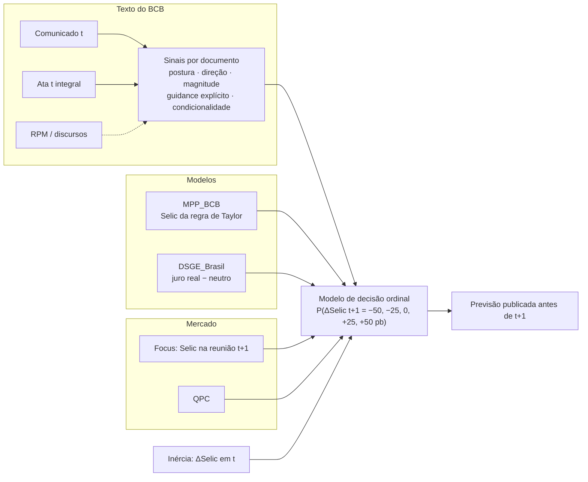

# Escopo v2.0: de "hawkish ou dovish" para "quanto a Selic muda na próxima reunião"

Rascunho de 21/11/2026. Decisões da seção 9 tomadas no mesmo dia. Código em `v2/`.

## 1. A pergunta nova

A v1.1 responde à pergunta: *qual o tom desta ata?* A calibração por OLS liga esse tom à ΔSelic **da mesma reunião**. O próprio paper aponta o limite: o índice mede o **nível** do aperto, não a **direção** da próxima decisão. No início dos cortes de 2026, os três LLMs seguiram lendo "hawkish" enquanto o Copom cortava.

A v2.0 responde a outra pergunta:

> Com tudo o que o BCB publicou até a véspera da reunião *t+1*, qual a distribuição de probabilidade da ΔSelic em *t+1*? Exemplo de saída: −50 pb: 10%, −25 pb: 70%, 0: 20%.

Três mudanças em relação à v1.1:

| | v1.1 | v2.0 |
|---|---|---|
| Alvo | ΔSelic da reunião da ata (contemporâneo) | ΔSelic da **próxima** reunião |
| Saída | score contínuo calibrado em p.p. | **distribuição sobre passos de 25 pb** |
| Informação | seções A+B de uma ata | todos os documentos do BCB no intervalo entre reuniões + modelos + mercado |

## 2. O que os projetos vizinhos já entregam

Não se reconstrói nada que já existe. Cada vizinho exporta um arquivo por reunião (ver seção 6), e este projeto consome.

| Projeto | O que tem pronto | Como entra aqui |
|---|---|---|
| **MPP_BCB** | v2 (2025) com **Selic endógena por regra de Taylor** (θ₃ = 1,64), câmbio por UIP, horizonte até 2028Q2; servidor MCP de cenários | **Selic implícita pelo modelo**: a distância entre a Selic corrente e a trajetória da Taylor do MPP indica para onde os fundamentos empurram |
| **DSGE_Brasil** | Chorinho estimado (bayesiana, variante tendências), **juro neutro** de 5,53% hoje (90%: 5,27–6,42), `src/copom.py` (Termômetro: Selic real ex-ante × neutro) | **Grau de aperto**: juro real menos neutro. Separa "a política está apertada" de "a política vai mudar", que é o ponto cego da v1.1 |
| **Taylor_Sentimento** | Índice **prospectivo** em 3 dimensões (retrospectivo, orientação prospectiva, balanço de riscos), corpus A+B sem truncagem, 42 edições do **Questionário Pré-Copom (QPC)** | Schema de escoragem e QPC prontos. Achado central: o balanço de riscos antecipa a ΔSelic seguinte (+0,146 p.p./dp), **mas o QPC já absorve quase tudo** (surpresa de −0,4 pb) |
| **COPOM_RAG_Service** | Atas integrais (`atas_full_cache.json`), Focus ancorado às reuniões | Coletores reaproveitáveis |
| **Coleta_Dados_Focus** | Coleta do Focus | Expectativa da Selic por reunião |

O achado do Taylor_Sentimento define a régua: **o mercado já sabe quase tudo o que a ata diz**. O valor da v2.0 está em três lugares, nesta ordem:

1. **Pontos de virada**, quando o Focus demora a mudar (o caso de 2026).
2. **A janela entre a ata e o Focus seguinte**, quando o texto já saiu e a pesquisa ainda não reagiu.
3. **A magnitude do passo** (25 ou 50 pb), que o Focus mediano arredonda.

Se o modelo não superar o Focus em nenhum dos três, esse é o resultado e vai para o paper.

## 3. Os documentos: o ciclo de informação entre duas reuniões

O BCB fala em momentos previsíveis entre a reunião *t* e a *t+1*. Cada documento tem um carimbo de publicação. **Só entra no conjunto de informação da reunião t+1 o que foi publicado antes do período de silêncio.**

| Momento | Documento | O que diz sobre *t+1* | Fonte | Desde | Status |
|---|---|---|---|---|---|
| Dia da decisão *t* | **Comunicado** | *Forward guidance* explícito ("antevê redução de mesma magnitude nas próximas reuniões") | `sitebcb/copom/comunicados` | reunião 46 (2000) | API confirmada em 21/11 |
| *t* + 6 dias | **Ata** (A+B+C) | Balanço de riscos, condicionalidades. Para prever *t+1*, a seção C (decisão de *t*) **pode** entrar, porque *t* já é conhecida | `sitebcb/copom/atas` | reunião 21 (1998) | Já coletada, hoje só A+B truncada |
| Trimestral | **Relatório de Política Monetária** (RPM) | Projeções no cenário de referência, juro neutro, boxes | site BCB (PDF) | 1999 | A verificar |
| Entre reuniões | **Discursos, apresentações e entrevistas** da diretoria | Ajuste fino do *guidance* | site BCB | ? | A verificar: API, transcrições |
| Semanal | **Focus**, Selic por reunião | Expectativa do mercado para *t+1* (mediana, média, dispersão) | Olinda `ExpectativasMercadoSelic` | reuniões de 2006 em diante | Coletado (F2) |
| Véspera de *t+1* | **QPC** | Expectativa dos analistas consultados pelo BCB | já no Taylor_Sentimento | 42 edições | Pronto |
| Diário | **DI futuro** | ΔSelic implícita nos preços e surpresa no dia de cada documento | SGS 7801–7806 (swaps DI × pré, até set/2019) + B3 `PRyymmdd.zip`, DI1 (desde jan/2019) | 2005 | F1, em `v2/f1_di.py` |

Ordem de prioridade: **comunicado e ata integral primeiro**. O comunicado é o documento com o sinal mais direto sobre *t+1* e ainda não é lido neste projeto. RPM e discursos entram só se a fase 5 mostrar que o texto agrega algo ao Focus.

## 4. Arquitetura



**Sinais de texto: postura separada de direção.** É a correção do ponto cego da v1.1. Para cada documento, o LLM devolve, com evidência por parágrafo:

- `postura`: quão restritiva a política está, de −3 a +3. É o que a v1.1 já mede.
- `direcao_proxima`: corte, manutenção ou alta.
- `magnitude_sinalizada`: em pb, ou nula quando não há sinal.
- `guidance_explicito`: verdadeiro ou falso, com o trecho citado.
- `condicionalidade`: quanto a decisão depende de dados futuros.

O schema parte do `schema_indice_prospectivo.json` do Taylor_Sentimento. Não começa do zero.

**Modelo de decisão.** A ΔSelic é discreta, em passos de 25 pb. O modelo é um **logit ordenado** com poucos regressores, nesta ordem de entrada:

1. Inércia: ΔSelic em *t*.
2. Focus: ΔSelic implícita para *t+1*.
3. Sinais do comunicado e da ata.
4. Hiato de Taylor do MPP e aperto do DSGE.

Cada bloco só fica se melhorar a previsão fora da amostra.

## 5. Avaliação

**Amostra.** Reuniões de 2005 em diante, cerca de 170, contra as 50 de hoje. O Focus por reunião começa em nov/2004, e desde 2006 o Copom faz 8 reuniões por ano. A escoragem de 170 comunicados e 170 atas integrais custa poucos dólares nos três modelos, na escala da seção 2.3 do README.

**Baselines que o modelo precisa vencer.** A ordem vai do mais fraco ao mais forte:

| Baseline | Regra |
|---|---|
| Inércia | ΔSelic(t+1) = ΔSelic(t) |
| Comunicado ingênuo | aplica o *guidance* explícito quando ele existe, senão a inércia |
| **Focus** | mediana da Selic para *t+1* na última pesquisa antes do silêncio, menos a Selic corrente |
| QPC | onde houver |

**Métricas.**

- Acerto exato do passo (%).
- *Log score* e Brier: a saída é uma distribuição, e essas métricas premiam a probabilidade calibrada.
- RMSE em pb.

Todas em *walk-forward* com janela expansiva, e reportadas à parte nos **pontos de virada**, onde o sinal da ΔSelic muda.

**Pré-registro.** A partir da reunião 283 (dezembro de 2026), a previsão é gravada com data **antes** da reunião, num arquivo versionado no git. É a única validação que não tem como vazar.

## 6. Contrato entre projetos

Cada vizinho grava, **no próprio repositório**, um arquivo por reunião. Este projeto lê o arquivo e não edita nada do vizinho.

```
<projeto>/exports/por_reuniao.csv
nro_reuniao, data_corte, variavel, valor, li, ls, vintage
```

- `data_corte`: a última data de dado usada. O ponto crítico está no próximo item.
- **Ponto-no-tempo.** Hoje o MPP e o DSGE são estimados com a amostra inteira. Usar o neutro de 2026 para "prever" uma reunião de 2015 é vazamento. São três saídas, em ordem de custo:
  1. **Reestimar por safra.** No MPP é OLS/TSLS, barato. No DSGE, a moda custa ~164 s por safra, ou ~8 h para 170 reuniões, viável à noite com o Mac na tomada. As cadeias MCMC por safra ficam fora do escopo.
  2. **Filtrar sem reestimar.** Parâmetros fixos e só o filtro de Kalman até `data_corte`. Fica a contaminação dos parâmetros, e ela precisa ser declarada.
  3. Usar os modelos **só na previsão ao vivo** (pré-registro) e deixá-los fora do *backtest*.

  Proposta: **(1) no MPP, (2) no DSGE**, com o rótulo explícito no paper.
- O MCP `mpp_*` da Análise Macro consome pontos da franquia. No *backtest*, o MPP roda pela biblioteca local `src/`, não pelo MCP.

## 7. Fases

| Fase | Entrega | Pronto quando |
|---|---|---|
| **F0 Calendário** | Tabela ponto-no-tempo por reunião: data da decisão, do comunicado, da ata, início do silêncio, Focus elegível | Uma linha por reunião desde 2005, testada contra o calendário oficial |
| **F1 DI** | Δ implícita no corte; surpresa do comunicado (decisão e caminho) e da ata | `v2/dados/di_por_reuniao.csv`, emenda SGS × B3 validada em jan–set/2019 |
| **F1 Corpus** | Comunicados e atas integrais desde 2005; Focus por reunião; QPC importado | Cache versionado, sem truncagem, com auditoria de cobertura |
| **F2 Baselines** | Inércia, comunicado ingênuo, Focus | Tabela de métricas em *walk-forward*: a régua |
| **F3 Sinais de texto** | Escoragem em 5 campos, 3 LLMs com versões fixadas (resolve a ressalva do Gemini) | Validação cega no protocolo do Taylor_Sentimento (Spearman > 0,70, sinal > 80%) |
| **F4 Modelos** | Exports de MPP (Taylor) e DSGE (aperto) por safra | `por_reuniao.csv` nos dois vizinhos, com `data_corte` |
| **F5 Decisão** | Logit ordenado, entrada bloco a bloco | Ganho fora da amostra **contra o Focus**, ou o registro de que não houve |
| **F6 Produção** | `atualizar_indice.py` estendido: previsão gravada antes de cada reunião; endpoint na API | Previsão da 283ª publicada antes da reunião |
| **F7 Cauda** | RPM e discursos | Só se a F5 mostrar ganho do texto |

F0 a F2 não chamam LLM e já dizem quanto espaço existe para o texto melhorar a previsão.

## 8. Resultado da F2 (21/11/2026): a régua é o DI, e ela muda o alvo

| Recorte | Inércia | Focus (mediana) | DI implícito |
|---|---:|---:|---:|
| 2005–2026, acerto exato (n = 165) | 63,0% | 81,8% | **87,9%** |
| 2019–2026, acerto exato (n = 63) | 63,5% | 85,7% | **96,8%** |
| Pontos de virada (n = 26) | 0% | 53,8% | **73,1%** |
| 2019–2026, RMSE | 24,0 pb | 9,4 pb | **5,3 pb** |

Previsões feitas na véspera da reunião (`data_corte`). Fonte: `v2/resultados/f2_baselines.csv`.

**Seis semanas antes, no dia da ata anterior** (2019–2026, n = 61): DI 72,1% e Focus 72,1% de acerto exato.

Leitura:

1. **Na véspera, o problema está quase resolvido pelo mercado.** O Copom leva o DI até a decisão antes do silêncio, e o DI erra 2 de 63 reuniões desde 2019. Prever a véspera com texto não tem espaço para ganho.
2. **A informação chega entre as reuniões.** O acerto do DI sobe de 72% no dia da ata para 97% na véspera. É nessas seis semanas que entram discursos, entrevistas, RPM e dados, que são exatamente os documentos da v2.0.
3. **A ata quase não move o mercado.** O desvio-padrão da surpresa no dia da ata é de 2,2 pb, contra 7,8 pb no dia seguinte ao comunicado. Isso confirma o achado do Taylor_Sentimento.

**Consequência para o desenho.** O alvo principal passa a ser a previsão **no dia da ata** (horizonte de ~6 semanas) e sua atualização a cada documento novo do BCB. A pergunta vira: *o texto antecipa para onde o DI vai convergir?* A régua é o DI na mesma data. O DI da véspera fica como teto e como verificação.

### 8.1 Resultado da F3a/F3b (21/11/2026): os discursos publicados não movem a curva

Catálogo: 1.556 textos e apresentações da diretoria desde 2002 (`sitebcb/discursos?ano=`), todos em PDF, sem entrevistas. Pela regra de título, ~290 são do presidente ou do diretor de Política Econômica sobre política monetária. Fonte: `v2/dados/discursos.csv`.

Estudo de evento: |variação em 2 dias| da taxa que cobre a próxima reunião, comparada a dias sem evento, com p-valor por permutação.

| Dia | 2006–2019 (swap 60d, SGS) | 2019–2026 (DI1, B3) |
|---|---:|---:|
| Dia seguinte ao comunicado | **2,19×** (p = 0,000) | — |
| Discurso/apresentação relevante | 0,96× (p = 0,66; 144 dias) | 0,91× (p = 0,72; 81 dias) |
| Ata | 0,58× (p = 1,00) | 1,03× (p = 0,43; 61 dias) |

Fonte: `v2/resultados/f3_evento.csv` e `f3_evento_b3.csv`.

**Decisão proposta:** não extrair nem escorar os PDFs dos discursos. O único texto do BCB que traz informação nova ao mercado é o **comunicado**. O que leva o acerto do DI de 72% (dia da ata) a 97% (véspera) está em outro lugar. Próxima frente: decompor a deriva do DI entre a ata e a véspera por dia e testar os dados divulgados (IPCA, IPCA-15, atividade, câmbio) e sua tradução pelo MPP.

Ressalvas: a data do catálogo é a de publicação no site; o tema vem de regra de título; o horário do evento é desconhecido (por isso a janela de 2 dias).

### 8.2 Resultado da F4 (21/11/2026): os dados do IBGE também explicam pouco

Calendário oficial do IBGE (`servicodados v3/calendario`, cobre 2017 em diante): 756 divulgações de IPCA, IPCA-15, PIB, PMC, PMS, PIM e PNAD. Medida: variação em 1 dia da Δ Selic implícita para a próxima reunião (sem o efeito mecânico do tempo no contrato). O IBGE divulga às 9h, antes do pregão.

| Divulgação | Dias | Movimento vs dia comum | p-valor |
|---|---:|---:|---:|
| **IPCA** | 108 | **1,30×** | **0,03** |
| IPCA-15 | 108 | 0,97× | 0,55 |
| PIM | 109 | 1,05× | 0,36 |
| PMS, PIB, PNAD, PMC | 38–108 | 0,89–0,98× | ≥ 0,52 |

- **Surpresa do IPCA** (divulgado − mediana do Focus na véspera, n = 108): +12,4 pb de Δ Selic precificada por 1 p.p. de surpresa (ep 5,1; p = 0,015; R² = 0,08). Uma surpresa típica de 0,1 p.p. move ~1 pb.
- **Deriva entre a ata e a véspera** (2019+, n = 55): a soma dos dias de divulgação não explica a deriva total (R² = 0,02). A medida diária é ruidosa no início da janela, porque a Δ implícita amplia o ruído da taxa quando faltam muitos dias para a reunião.

Fonte: `v2/resultados/f4_*.csv`.

**Leitura conjunta da F2–F4.** Entre a ata e a véspera, o mercado vai de 72% para 97% de acerto, mas essa informação **não está concentrada** em nenhum dos eventos datados que dá para medir: nem nos textos publicados pelo BCB, nem na ata, nem nas divulgações do IBGE (só o IPCA tem efeito, pequeno). Ela chega espalhada pelos dias comuns. Candidatos não medidos: falas da diretoria fora do site (entrevistas, eventos, *off*), cenário externo (juros dos EUA, câmbio), notícias fiscais.

### 8.3 Resultado da F5 (21/11/2026): o comunicado não acrescenta nada ao DI

Leitura dos 179 comunicados (2005–2026) por Claude Haiku 4.5 (`claude-haiku-4-5-20251001`), GPT-4.1-mini (`gpt-4.1-mini-2025-04-14`) e Gemini (`gemini-3.5-flash-lite`, versão fixa), separando **postura** (nível do aperto) de **direção sinalizada** para a próxima reunião. Previsão feita no dia da ata de *t* para a reunião *t+1* (178 reuniões-alvo).

| Previsor (acerto do passo exato) | 2005–2026 | Com guidance explícito | Sem guidance | 2019–2026 |
|---|---:|---:|---:|---:|
| DI no dia da ata | 61% | 63% | 60% | 70% |
| Focus no dia da ata | 61% | 68% | 55% | 70% |
| Repetir a última decisão | 63% | 57% | 69% | 61% |
| Comunicado (Claude / GPT / Gemini) | 50% / 46% / 47% | 62% / 57% / — | 39% / 36% / — | 66% / 62% / — |

- **Walk-forward** (138 previsões, treino mínimo de 40): DI sozinho 65,9%; DI + comunicado 55,1%; com postura e inércia, 55,1%.
- **Deriva do DI até a véspera** ~ (comunicado − DI): coeficiente 0,03 (p = 0,39), R² = 0,005. O comunicado não antecipa a correção do mercado.
- **Viradas de ciclo** (28): os LLMs leem "manutenção" na maioria; o Copom raramente antecipa a virada no comunicado anterior. Exceção: mar/2026 (277), ponto cego da v1.1, lido como corte de 25 pb por todos.

Fonte: `v2/resultados/f5_*.csv`, `v2/dados/base_dia_ata.csv`.

**Conclusão da F2–F5.** A comunicação escrita do BCB (comunicado, ata, discursos) e os dados do IBGE já estão no preço. Nada do que foi medido acrescenta informação à curva de juros, nem na véspera nem seis semanas antes. Hipótese ainda em aberto: os fundamentos traduzidos pelos modelos (hiato de Taylor do MPP, aperto vs neutro do DSGE).

**Caminhos (a decidir):** (1) paper com resultado negativo documentado; (2) testar MPP e DSGE antes de fechar, o que exige os exports por reunião nos projetos vizinhos; (3) produto: distribuição de probabilidade da próxima decisão extraída do DI, diária, com LLM explicando o que mudou.

### 8.4 Resultado da F6, primeira rodada (21/11/2026): fundamentos do MPP e do DSGE

Exports por reunião dos dois projetos (contrato em `docs/CONTRATO_EXPORTS.md`), conferidos: nenhum dado posterior à data da ata, datas iguais às do calendário, última safra validada contra a amostra inteira. Amostra comum: 146 reuniões-alvo (atas de jul/2008 em diante).

| Walk-forward (106 previsões) | Acerto exato | RMSE |
|---|---:|---:|
| DI no dia da ata | **66,0%** | 17,4 pb |
| DI + gap de Taylor (MPP) | 51,9% | 17,8 pb |
| DI + aperto (DSGE) | 50,9% | 18,8 pb |
| DI + MPP + DSGE | 52,8% | 18,9 pb |

Deriva do DI até a véspera ~ fundamentos: nenhum coeficiente significativo (p ≥ 0,34; R² ≤ 0,01).

**Diagnóstico.** O `gap_taylor_pb` tem correlação −0,62 com a ΔSelic seguinte e −0,78 com a corrente: com suavização de 0,94, a Selic da regra fica sempre atrás da Selic e mede inércia. Erro da especificação do contrato. Adendo pedindo a `selic_alvo` (a regra sem suavização). O aperto do DSGE tem correlação +0,24 com a ΔSelic seguinte: o nível do aperto acompanha o ciclo com atraso, o mesmo ponto cego da v1.1. **Rodada a repetir com a `selic_alvo`.**

### 8.5 Resultado da F6, segunda rodada (21/11/2026): a Selic-alvo da regra também não acrescenta

Export do MPP atualizado (vintage `7fc5b95`) com `selic_alvo` = `jr2hp + âncora + θ3·(eipca12 − âncora)`, sem suavização. Recalculada aqui a partir dos insumos: diferença máxima de 1e-6.

| Walk-forward (106 previsões) | Acerto exato | RMSE | Acerto nas viradas (15) |
|---|---:|---:|---:|
| DI no dia da ata | **66,0%** | **17,4 pb** | 33% |
| DI + gap do alvo (MPP) | 53,8% | 18,1 pb | 40% |
| DI + gap do alvo + aperto (DSGE) | 52,8% | 19,1 pb | 47% |

- O gap do alvo acerta o sinal em 38% das reuniões com mudança; correlação −0,25 com a ΔSelic seguinte e −0,42 com a corrente. O juro neutro por HP (`jr2hp`) acompanha o juro real com atraso, e o gap volta a medir o ciclo passado.
- Deriva do DI até a véspera ~ gap do alvo: coeficiente −0,002 (p = 0,65), R² = 0,001.
- Nas viradas, MPP + DSGE sobem de 33% para 40–47%, mas com 15 viradas e perda no total. Não é evidência.

**Conclusão da v2.0 (F2–F6).** Nada do que foi testado acrescenta informação ao DI para prever a próxima decisão do Copom: comunicado e ata lidos por três LLMs, discursos da diretoria, dados do IBGE, regra de Taylor do MPP (suavizada e sem suavização) e aperto em relação ao neutro do DSGE. O mercado acerta 61–66% no dia da ata e 97% na véspera, e a informação que fecha essa diferença chega espalhada pelos dias comuns. O resultado é negativo e robusto, e vira o eixo do paper da v2.0.

Leitura ao vivo para a 283ª (dez/2026), no dia da ata da 282ª: regra do MPP sem suavização 16,34% (gap +259 pb), com suavização 14,35%; DSGE: juro real 2,0 p.p. acima do neutro de 5,79%.

## 9. Decisões para o Vitor

1. **Versão.** ✅ Decidido em 21/11/2026: v2.0 **neste repositório**, com a v1.1 congelada numa tag.
2. **Amostra.** ✅ Decidido em 21/11/2026: começa em **2005** (~170 reuniões), com recorte de robustez a partir de 2016.
3. **Ponto-no-tempo dos modelos.** ✅ Decidido em 21/11/2026: MPP reestimado por safra; DSGE com parâmetros fixos e filtro até `data_corte`, contaminação declarada.
4. **Mercado.** ✅ Decidido em 21/11/2026: o DI entra **já**, como baseline (Δ implícita no corte) e como medida de surpresa no dia do comunicado e da ata.
5. **Quem escreve nos vizinhos.** O `exports/` do MPP e do DSGE é criado numa sessão aberta em cada projeto, seguindo as regras de rastreabilidade de cada CLAUDE.md, e não a partir daqui.
