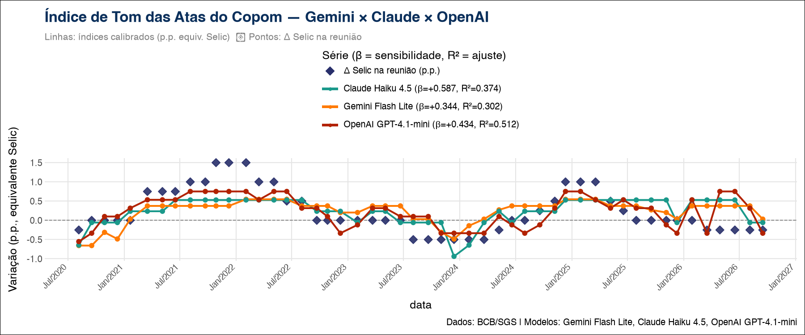

{width=100%}

::: {.callout-note}
## 🔗 Camada de serviço sobre o paper

Esta ficha documenta a **API** construída sobre o projeto
[Sentimento COPOM](sentimento-copom.qmd). O paper produz e valida o Índice de Tom;
esta camada o **transforma de documento que se lê em serviço que se consulta** —
um endpoint HTTP que a mesa de operação (ou outro sistema) chama para obter o tom
da última ata em JSON, na hora. Nada da metodologia do paper é reimplementado: a
API **serve os scores que o pipeline já produziu**.
:::

## Visão Geral

Este projeto implementa, seguindo a metodologia **CRISP-DM**, uma **API** (FastAPI
+ Docker) que serve o **Índice de Tom *hawkish-dovish*** das atas do Copom. O
índice já existe, calibrado e validado, como resultado do paper
[Sentimento COPOM](sentimento-copom.qmd) — três LLMs em paralelo (Gemini Flash
Lite, Claude Haiku 4.5 e GPT-4.1-mini) escorando o tom de cada ata, calibrado em
pontos percentuais da Selic via OLS.

O salto aqui é de **natureza**, não de método: um *paper* comunica pesquisa, mas
não é consumível por outro sistema. Ninguém abre um PDF toda vez que quer o tom da
ata mais recente. A API muda isso — um `GET /indice` devolve a série completa em
JSON; um `GET /score/{reuniao}` devolve o tom de uma reunião com o detalhe por
modelo. O índice deixa de ser um documento e vira uma **fonte de dados viva**.

::: {.callout-tip}
## Tese de engenharia

A API é desenhada em torno de uma separação deliberada: **leitura offline e
barata** vs. **escrita cara e sob demanda**. Os quatro endpoints de consulta
servem os *scores já escorados* (50 reuniões em cache) — sobem funcionais no
primeiro `docker compose up`, **sem chave de API e sem chamar LLM**. Só o
`POST /atualizar` toca rede e modelos, e apenas para atas ainda não escoradas.
Essa fronteira é o que faz o MVP estar de pé a custo marginal zero: o gasto de LLM
foi pago uma única vez, na construção do índice; a API apenas o distribui.
:::

---

## Motivação

### O problema de negócio: do índice ao consumo

Imagine este serviço dentro de um **departamento de pesquisa macroeconômica de
banco**. O paper entrega um indicador quantitativo e defensável do tom do Copom —
mas entregue como PDF, ele não integra fluxo nenhum. A **mesa de operação** (juros
/ *rates*), o cliente interno mais crítico, precisa do tom da ata **em minutos após
a publicação**, num formato que um dashboard, uma planilha ou um bot consiga
consumir automaticamente. Um número em p.p. de Selic — "este tom equivale a +0,6
p.p." — é diretamente acionável para posicionar em DI/pré; um parágrafo num PDF
não é.

A API resolve o *last mile*: pega o índice já validado e o expõe num contrato
estável (JSON tipado via Pydantic), documentado automaticamente, versionável e
*deployável*. É a diferença entre "publiquei um estudo" e "publiquei uma fonte de
dados que outros sistemas consomem".

### Par com o COPOM RAG Service

Este serviço forma um **par** com o [COPOM RAG Service](../../COPOM_RAG_Service/portfolio/copom-rag-service.qmd)
na frente de portfólio *AI/LLM Engineer*, sobre o mesmo objeto — a comunicação do
Copom — com papéis complementares:

- **Sentimento COPOM API** — serve um **sinal quantitativo**: o tom da ata em p.p.
  de Selic (ensemble de três LLMs, calibrado).
- **COPOM RAG Service** — serve uma **leitura qualitativa**: responde perguntas
  sobre as atas com fontes citadas.

Um dá o número; o outro dá a explicação. Ambos como API, ambos com a mesma postura
de engenharia (contratos Pydantic, observability, Docker).

### As perguntas de engenharia

1. **Como servir um índice de pesquisa** sem re-executar o pipeline caro a cada
   consulta?
2. **Como manter o custo marginal em zero** para leitura, isolando o gasto de LLM
   num único caminho sob demanda?
3. **Como garantir reprodutibilidade** — que a API suba idêntica na máquina do
   analista, no servidor do banco ou num cluster?

---

## Metodologia — CRISP-DM

| Fase | Aplicação nesta camada |
|---|---|
| **1. Entendimento do Negócio** | Servir o Índice de Tom como fonte de dados consultável pela mesa, em p.p. de Selic, com custo marginal zero na leitura |
| **2. Entendimento dos Dados** | Artefatos já produzidos pelo paper: atas (`atas_cache.json`), scores dos três LLMs (`scores_*_cache.csv`) e Selic (`selic_cache.json`) |
| **3. Preparação dos Dados** | Camada de repositório (`data/repo.py`) que lê e normaliza os caches; tolera o schema por provedor; 100% offline |
| **4. Modelagem** | Agregação **ensemble** (média dos três modelos) + **z-score** na amostra + **calibração OLS** ΔSelic ~ score, por modelo e ensemble |
| **5. Avaliação** | Suíte **pytest** offline (13 testes): contratos dos endpoints, consistência do ensemble, sinal econômico da calibração ($\hat\beta > 0$) |
| **6. Implantação** | **API FastAPI + Docker/compose**; healthcheck; observability de latência por *request* |

---

## Arquitetura

```{mermaid}
flowchart LR
  subgraph Clientes
    MESA[Mesa / dashboard / bot]
  end

  MESA -->|GET /indice /score /calibragem| API[FastAPI]

  subgraph Leitura offline — custo zero
    API --> REPO[data/repo.py<br>lê caches]
    REPO --> C1[(atas_cache.json)]
    REPO --> C2[(scores_*_cache.csv)]
    API --> IDX[index/tone_index<br>ensemble + z-score]
    API --> CAL[index/calibra<br>OLS ΔSelic ~ score]
    CAL --> C3[(selic_cache.json)]
  end

  subgraph Escrita sob demanda — toca LLM
    API -->|POST /atualizar| ING[ingest/collector<br>coleta BCB]
    ING --> SCO[scoring/scorer<br>3 LLMs + Pydantic]
    SCO --> C2
  end

  API -. latência por request .-> OBS[obs/tracing]
```

---

## 1. Entendimento do Negócio

### 1.1 Problema

O Índice de Tom, na forma de *paper*, é preciso mas **não integrável**. Para a mesa
de operação, o tom da ata só é útil se chegar **rápido, em minutos**, e num formato
que **um sistema consiga consumir** — não um humano relendo um PDF. O problema desta
camada é de *distribuição e contrato*: expor o índice já validado como serviço, com
uma interface estável, sem reabrir a caixa da metodologia.

### 1.2 Objetivos

1. Expor endpoints HTTP que devolvam o Índice de Tom e o score por reunião em JSON
   tipado, incluindo o **equivalente em p.p. de Selic**;
2. Manter a **leitura offline** — sem chave, sem LLM — servindo os scores já
   escorados;
3. Isolar toda chamada a LLM/rede num **único endpoint sob demanda**
   (`POST /atualizar`);
4. Empacotar como **API + Docker** reprodutível, coerente com o COPOM RAG Service.

### 1.3 Públicos-alvo (clientes internos)

| Público-alvo | O que ganha |
|---|---|
| **Mesa de *rates* / juros** | O tom da ata em p.p. de Selic, em JSON, em minutos — acionável para posicionar em DI/pré |
| **Dashboards / BI** | Uma fonte estável para plotar a série do índice sem reprocessar nada |
| **Economista / cenário** | Consulta pontual do score de uma reunião com o detalhe por modelo |
| **Engenharia / deploy** | Um serviço *dockerizado*, com healthcheck, pronto para subir num servidor |

### 1.4 Critérios de sucesso

| Critério | Meta |
|---|---|
| Leitura sem custo | `/indice`, `/score`, `/calibragem`, `/modelos` sobem sem chave e sem LLM |
| Contrato estável | Toda resposta validada por um modelo Pydantic (JSON tipado + OpenAPI) |
| Fidelidade ao paper | Ensemble e calibração OLS reproduzem os $\hat\beta$ do pipeline |
| Reprodutibilidade | `docker compose up --build` sobe a API respondendo em `/health` |
| Regressão | Suíte pytest verde (contratos + sinal econômico da calibração) |

---

## 2. Entendimento dos Dados

A API não coleta nem escora nada no caminho de leitura — ela **consome os artefatos
do paper**:

| Artefato | Conteúdo | Papel na API |
|---|---|---|
| `atas_cache.json` | 50 atas (reuniões 232–281), seções A+B limpas | Datas das reuniões; texto para reescoragem |
| `scores_{gemini,claude,openai}_cache.csv` | Score de tom [-3, +3] por reunião, por modelo | **Fonte de verdade** do índice servido |
| `selic_cache.json` | Meta Selic diária (SGS 432) | Variável dependente da calibração OLS |

A cobertura atual é de **50 reuniões escoradas nos três provedores** — o índice sobe
completo no primeiro *boot*.

---

## 3. Preparação dos Dados

A camada `data/repo.py` centraliza a leitura dos caches e os expõe como estruturas
Python limpas, com dois cuidados: (i) **tolerância de schema** — o cache do Gemini
tem uma coluna `data` extra que os demais não têm, lida sem quebrar; (ii)
**cache em memória** (`lru_cache`) invalidado após uma atualização. Nenhuma
operação de leitura toca rede ou LLM.

---

## 4. Modelagem

### 4.1 Ensemble e z-score

O `index/tone_index.py` agrega os três modelos por **média simples** (ensemble) por
reunião e padroniza a série em **z-score** — a leitura "esta ata é quão mais
*hawkish*/*dovish* que a média histórica?".

### 4.2 Calibração OLS na Selic

O `index/calibra.py` replica o exercício central do paper, estimando por OLS, para
cada modelo e para o ensemble:

$$ \Delta \text{Selic}_t = \alpha + \beta \cdot \text{Score}_t + \varepsilon_t $$

O $\hat\beta$ é a **sensibilidade** — quantos pontos percentuais de Selic cada
unidade de *score* representa —, o que traduz o índice qualitativo no número que a
mesa quer. A ponte ata → variação da Selic (`index/selic.py`) reproduz a regra do
paper: primeira variação não-nula da meta numa janela de ±10 dias ao redor da
reunião. A calibração roda com `numpy` (mínimos quadrados), entregando $\hat\alpha$,
$\hat\beta$ e $R^2$; os erros-padrão e as três camadas de validação do paper
(*in-sample*, *holdout*, *walk-forward*) ficam como próximo passo.

### 4.3 Reaproveitamento do pipeline validado

A coleta (`ingest/collector.py`) e a escoragem (`scoring/scorer.py`) reaproveitam
**byte-a-byte** a lógica já validada de `atualizar_indice.py` — mesmo *prompt*
calibrado, mesma escala [-3, +3], mesma saída Pydantic via LangChain,
`temperature=0`, *prompt caching* no Claude —, apenas reorganizada como módulos
importáveis. A API não reimplementa o método; ela o serve e, quando pedido, o
estende.

---

## 5. Avaliação

A qualidade da camada é verificada por uma suíte **pytest** 100% *offline* (sem
chave, sem rede), com **13 testes**:

- **Contratos dos endpoints** — `/health`, `/modelos`, `/indice`, `/calibragem`,
  `/score/{n}` respondem com o schema esperado; reunião inexistente → 404;
- **Consistência do ensemble** — o ensemble de um ponto é, de fato, a média dos
  scores dos provedores disponíveis;
- **Sinal econômico da calibração** — $\hat\beta$ do ensemble é **positivo** (tom
  mais *hawkish* ⇒ alta de Selic) e a tradução score → Selic é monotônica.

O container foi validado de ponta a ponta: `docker compose up --build`, healthcheck
`healthy`, e `curl` nos endpoints a partir do *host* devolvendo o JSON esperado.

::: {.callout-note}
## Escoragem ao vivo — validada por teste de fumaça

O caminho de escoragem do `POST /atualizar` foi exercitado ao vivo num teste de
fumaça isolado: o *scorer* real escorou a ata 279 nos três provedores e reproduziu
**exatamente** os scores em cache (Gemini +1,5, Claude +1,5, OpenAI +2,0),
confirmando também o determinismo (`temperature=0`). O endpoint completo em
produção contínua — coleta de ata nova → escoragem → *append* no cache — só
dispara quando o BCB publica uma ata inédita; até lá, é idempotente.
:::

---

## 6. Implantação

Empacotado como **API FastAPI + Docker**:

- `src/Dockerfile` — imagem `python:3.11-slim`, healthcheck no `/health`, copia os
  caches do pipeline para dentro da imagem (a fonte de verdade da leitura);
- `docker-compose.yml` — sobe a API na porta 8000; `.env` opcional (só para
  `POST /atualizar`);
- `.dockerignore` — mantém o contexto enxuto (fora `tests/`, `.venv`, artefatos do
  paper).

```bash
docker compose up --build     # API respondendo em http://localhost:8000
curl http://localhost:8000/indice
```

---

## Estrutura do Projeto

```
Sentimento_COPOM/
│
├── sentimento_copom_IA_base.qmd     # o paper (pipeline + validação)
├── atualizar_indice.py              # escoragem incremental (reusado pela API)
├── atas_cache.json  selic_cache.json
├── scores_{gemini,claude,openai}_cache.csv
│
├── src/                             # ← A API (esta ficha)
│   ├── app/main.py                  # FastAPI — os endpoints
│   ├── core/{config,schemas}.py     # caminhos + contratos Pydantic
│   ├── data/repo.py                 # leitura dos caches (offline)
│   ├── index/{tone_index,calibra,selic}.py   # ensemble, z-score, OLS
│   ├── ingest/collector.py          # coleta BCB (do atualizar_indice.py)
│   ├── scoring/scorer.py            # escoragem 3 LLMs (do atualizar_indice.py)
│   ├── obs/tracing.py               # latência por request
│   ├── tests/test_api.py            # 13 testes offline
│   ├── Dockerfile  requirements.txt  .env.example
│   └── README.md
│
├── docker-compose.yml  .dockerignore
└── portfolio/                       # divulgação CRISP-DM
    ├── sentimento-copom.qmd         # ficha do paper
    └── sentimento-copom-api.qmd     # ESTA ficha
```

---

## Tecnologias

| Camada | Tecnologia |
|---|---|
| **API** | FastAPI + uvicorn |
| **Contratos / saída estruturada** | Pydantic v2 |
| **Agregação / calibração** | numpy (ensemble, z-score, OLS) |
| **Coleta** | requests + BeautifulSoup |
| **Escoragem (POST /atualizar)** | LangChain (Gemini, Claude, OpenAI) |
| **Observability** | *context manager* próprio (`obs/tracing.py`) |
| **Testes** | pytest |
| **Empacotamento** | Docker + docker-compose |

---

## Como Executar Localmente

### Sem Docker

```bash
cd src
python3 -m venv .venv && source .venv/bin/activate
pip install -r requirements.txt
uvicorn app.main:app --reload --port 8000    # http://localhost:8000/docs
```

### Com Docker

```bash
docker compose up --build                    # a partir da raiz do projeto
```

### Testes

```bash
cd src && pytest -q                          # 13 testes, offline
```

---

## Próximos Passos

1. **Calibração completa na Selic** — expor erros-padrão, IC e as três camadas de
   validação do paper (*in-sample*, *holdout*, *walk-forward*), não só $\hat\beta$.
2. **Eval harness** — *golden set* de tom + gate de regressão que **falha (exit 1)**
   se a qualidade do scoring regride, espelhando o COPOM RAG Service.
3. **`POST /atualizar` assíncrono** — hoje é síncrono; mover para *background task*.
4. **Observability real** — somar tokens/custo no caminho de escoragem e exportar
   (OpenTelemetry / Prometheus).
5. **CI** — *GitHub Action* rodando a suíte pytest a cada PR.

---

## Referências

- Ver a ficha do paper [Sentimento COPOM](sentimento-copom.qmd) para a
  bibliografia completa (Loughran & McDonald, Hansen & Kazinnik, Apel & Grimaldi,
  Blinder et al.).
- Ramírez, S. et al. *FastAPI Documentation*. <https://fastapi.tiangolo.com>.
